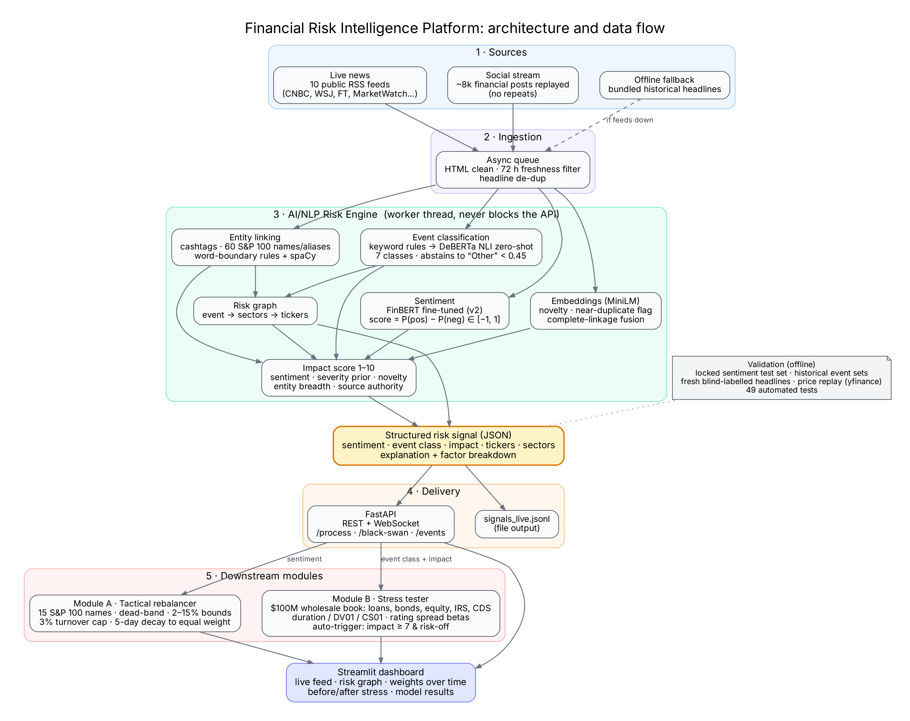

# Financial Risk Intelligence Platform - S&P Global & Crisil Campus Hackathon

**Candidate Name:** Lakshay Gupta
**College Email ID:** lakshay24318@iiitd.ac.in
**College / Campus:** Indraprastha Institute of Information Technology Delhi (IIIT-Delhi)
**Demo Video Link:** [YouTube (unlisted)](https://youtu.be/pwDndOU4AfQ)
**Slide Deck Link (if hosted externally):** [docs/presentation.pdf](docs/presentation.pdf) (in this repository)

## 1. Project Overview / Problem Statement & Approach

Risk teams read more news than any person can. A headline about a Taiwan blockade, a bank failure or an emergency rate hike matters within minutes, but it arrives as unstructured text. This project turns that text into structured, machine-readable risk signals and acts on them.

The core is an **AI/NLP Risk Engine**. It ingests live financial news (10 public RSS feeds) and a social stream, and for every item produces a JSON signal with a **sentiment score** in [-1, 1], an **event class**, a **1-10 impact score**, the S&P 100 tickers and sectors affected, and an explanation of how the impact score was built. The engine uses a FinBERT model I fine-tuned on financial posts, a keyword + NLI zero-shot event classifier that abstains when unsure, and sentence embeddings for novelty and duplicate detection.

Both downstream modules are implemented:

- **Module A - Tactical index rebalancer.** A 15-stock index from the S&P 100 tilts toward positive and away from negative sentiment, within risk limits (2-15% per name, 3% turnover cap, 5-day decay back to equal weight). The dashboard shows the weights changing over time.
- **Module B - Strategic stress tester.** A synthetic $100M wholesale banking book (loans, bonds, equities, interest-rate and credit-default swaps) is stress-tested automatically when a high-impact risk-off event arrives (impact >= 7). Positions are repriced with duration, DV01/CS01 and rating-based spread sensitivities, and the dashboard shows the portfolio before and after, with loss attribution.

## 2. Architecture & Tech Stack



**Data flow:** sources -> async ingestion queue (freshness filter, de-dup) -> NLP engine in a worker thread (entity linking, sentiment, event classification, embeddings, risk graph, impact score) -> structured signal -> FastAPI (REST + WebSocket) and a JSONL file -> Module A and Module B -> Streamlit dashboard.

| Layer | Choice | Why |
|---|---|---|
| Sentiment | FinBERT (`ProsusAI/finbert`) fine-tuned -> [`LakshG299/finbert-financial-sentiment-v2`](https://huggingface.co/LakshG299/finbert-financial-sentiment-v2) | Finance-specific language; +0.16 macro-F1 over the pretrained model |
| Event classification | Regex keyword rules -> `cross-encoder/nli-deberta-v3-small` zero-shot | Rules are precise and explainable; NLI handles the long tail; abstains to "Other" below 0.45 confidence |
| Embeddings | `sentence-transformers/all-MiniLM-L6-v2` | Fast novelty scoring, duplicate suppression, complete-linkage event fusion |
| Entity linking | Cashtags, 60 company names/aliases on word boundaries, spaCy `en_core_web_sm` | Avoids false hits such as "metals" -> META or "Visa restrictions" -> V |
| Risk graph | NetworkX | Event -> sectors -> tickers propagation |
| API | FastAPI, Uvicorn, WebSocket | Models run in a worker thread so the API never blocks |
| Dashboard | Streamlit, Plotly, PyVis | Live feed, risk graph, weights over time, before/after stress |
| Market data | yfinance | Historical prices for validation and the Module A replay |
| Testing | pytest (49 tests, offline with small fake models) | Unit and end-to-end API tests run in seconds without downloads |

## 3. Dataset Used

All data is public or synthetic. No S&P Global or Crisil client data is used.

| File (`data/`) | Source / nature | Used for |
|---|---|---|
| `train_sentiment.csv`, `test_set.csv` | **Twitter Financial News Sentiment** (public; Kaggle / Hugging Face `zeroshot/twitter-financial-news-sentiment`), 9,543 finance posts labelled bearish / bullish / neutral. Split into 8,111 training and 1,432 **locked test** rows | Fine-tuning and evaluating the sentiment model |
| `master_tuning_set.json`, `master_holdout_set.json` | 45 real, dated historical headlines (2022-2024) with expected event class and affected tickers, labelled by me | Event-classification validation, market-reaction checks, Module A replay |
| `fresh_test_set.csv` | 37 live headlines collected on 11 Oct 2026, **labelled blind before running the model** | Unseen event-classification test |
| `synthetic_portfolio.json` | Synthetic $100M wholesale book: 3 loans, 4 bonds, 4 equities, 1 IRS, 1 CDS, with ratings, durations, DV01/CS01 | Module B |
| `shock_templates.json`, `risk_graph_static.json` | Hand-specified scenario shocks per event class; event -> sector map | Module B, risk graph |
| `sp100_tickers.csv` | Public S&P 100 constituents (60 used) with sectors | Entity linking |
| `tweet_signals_daily.csv`, `tweet_study_results.json` | Daily sentiment per stock derived from the public Kaggle dataset **"Tweet Sentiment's Impact on Stock Returns"** (raw 226 MB file not committed; download it to `data/archive/`) | Tweet signal study, Module A replay at scale |
| `gdelt_curated_events.json`, `historical_events*.json` | Earlier event lists (headlines from public news via GDELT) | Kept for transparency; superseded by the master sets |
| Live RSS / `train_sentiment.csv` replay | Public RSS headlines at run time; the social stream replays training posts as a simulated feed | Live demo |

**Assumptions**

- The historical event files have dates but no publication times, so all market measurements start at the **next trading-day open** (no look-ahead).
- Seven event classes: the five case-study examples, plus **Earnings/Corporate** (earnings, guidance, layoffs, recalls, strikes, analyst actions: the most common headline type) and **Other** (market commentary and non-events). 23 historical events were relabelled to the new class; original labels are kept in `event_class_original`.
- Impact weights and severity priors are transparent domain priors, not fitted coefficients.
- Social input is a replay of real posts, not a live X/Twitter API connection (no free tier exists).

## 4. Quickstart & Installation

Runtime: Python 3.11 on Linux (also runs on macOS/Windows). First run downloads the Hugging Face models (~1 GB), so internet is needed once.

```bash
git clone https://github.com/LakshayGupta29/iiitd-lakshay-gupta-hackathon.git
cd iiitd-lakshay-gupta-hackathon
python -m venv .venv && source .venv/bin/activate      # Windows: .venv\Scripts\activate
pip install -r requirements.txt
python -m spacy download en_core_web_sm
```

Run the app (two terminals):

```bash
python -m uvicorn src.api.main:app          # API on http://127.0.0.1:8000 (docs at /docs)
streamlit run src/dashboard/app.py          # dashboard on http://localhost:8501
```

Optional settings: `DISABLE_LIVE_FEEDS=1` runs without RSS/social streams (if no feed is reachable the app replays bundled headlines automatically); `HF_FINETUNED_MODEL=<repo>` selects another sentiment model (falls back to `ProsusAI/finbert` if it cannot load).

Tests and results:

```bash
python -m pytest -q                         # 49 offline tests, no downloads needed
bash scripts/reproduce_results.sh           # regenerates every result file in data/
```

| Command | Output |
|---|---|
| `python -m src.engine.evaluator --mode all` | `data/eval_results.json` - sentiment metrics on the locked test set |
| `python -m src.modules.validation_backtest --split holdout` (and `tuning`) | `data/validation_results_*.json` |
| `python scripts/fresh_test_set.py score` | `data/fresh_test_results.json` |
| `python -m src.modules.module_a --rebuild` | `data/backtest_results.json` - Module A replay |

Model training: `notebooks/03_finetune_sentiment.ipynb` (Kaggle GPU; the locked test set is never used for checkpoint selection).

## 5. Key Results & Domain Impact

**Sentiment** - locked test set of 1,432 posts, never seen in training or model selection:

| Model | Macro-F1 | Accuracy |
|---|---|---|
| VADER (rule-based) | 0.445 | 48.2% |
| FinBERT (pretrained) | 0.640 | 69.0% |
| **FinBERT fine-tuned (this project)** | **0.800** | **83.5%** |

**Event classification** - about twice the majority-class baseline on every test set:

| Test set | Accuracy | Majority baseline |
|---|---|---|
| Fresh blind-labelled live headlines (n=37) | **64.9%** (95% CI 49-78%) | 32.4% |
| Historical holdout (n=18) | **77.8%** | 50.0% |
| Historical tuning (n=27) | **74.1%** | 51.9% |

Recall is 100% for Geopolitical and Credit Event on both historical sets: the classes that trigger stress tests. Ticker recall on the blind set is 75%.

**Module A** (45 dated historical headlines replayed on real prices, 683 trading days, 5 bp costs): the rebalancer reacts to news within its risk limits and decays back to neutral. It finished **-0.06 pp** versus equal weight, a statistical tie, which is expected with 20 signals in almost three years. The replay validates the mechanics, not a trading edge.

**Module B**: a Taiwan-blockade headline triggers an automatic stress test of about -6% (about $6M) on the $100M book, attributed by sector, asset type and position, with the CDS hedge shown offsetting losses. Good news (a product launch, a defence contract win) never triggers a test, and near-duplicate headlines never trigger a second one.

**Tweet signal study** (Kaggle "Tweet Sentiment's Impact on Stock Returns": 77,145 tweets on 9 index stocks, 2017-2018; 8,364 scored, capped at 12 per stock-day, giving 916 stock-days). Daily mean sentiment from the fine-tuned model has a **weak but consistent contrarian relationship** with forward returns: rank IC -0.06 (1 day), -0.09 (2 days, p = 0.008), -0.08 (3 days, p = 0.02), -0.05 (7 days). The sign is negative at every horizon in both halves of the period, and the dataset's own TextBlob scores show the same pattern. In plain terms, very positive social chatter tended to come before slightly weaker returns. Module A's momentum tilt is therefore the wrong sign for social data; its replay on these signals was a tie (+0.11 pp vs equal weight). The effect is small (|IC| < 0.1, 9 stocks, 2 years), so it is reported as a finding to test out of sample, not as a trading rule. Script: `python scripts/tweet_signal_study.py`; outputs in `data/tweet_study_results.json`.

**What the evidence does not show.** On 45 historical events, sentiment direction versus the next 5 days' market-adjusted move was 51% (a coin flip at this sample size), and the impact score did not predict the size of the move. The impact score is used as a triage score that decides which events deserve a stress test, not as a return forecast.

**Why it matters**

- **Early warning.** Every headline is scored in about a second, with an explanation a risk analyst can check.
- **Event-driven stress testing.** Instead of quarterly scenario runs, the book is stress-tested within seconds of a relevant event, with the loss broken down by sector, asset type and position.
- **Trustworthy by design.** The classifier abstains rather than guess, duplicates are suppressed, every number has a reproducible script, and the app keeps working offline.

**Limitations and next steps:** small historical event sample; impact weights not yet calibrated against outcomes; Module B uses first-order sensitivities (no default/PD-LGD modelling or full revaluation); social input is a replay. Next: test a contrarian tilt for social sources on later, unseen data (news kept separate), calibrate impact weights on a larger dated news archive, add PD/LGD credit losses, connect a live social API.
